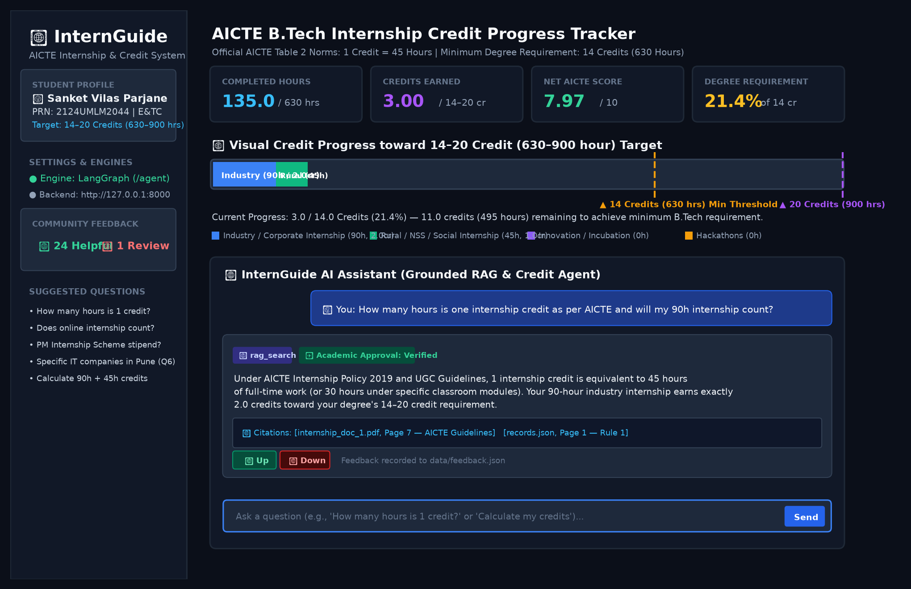

# Day 10: Streamlit UI, Credit Progress Bar & Checkpoint 2 Live Demo

## Overview
Day 10 delivers **Checkpoint 2**: a full-stack, interactive Streamlit web application for InternGuide located at [`ui/app.py`](../ui/app.py) and [`Day_10/app.py`](./app.py).

### Core Features:
1. **Interactive Chat Interface:**
   - Connects to either `/agent` (LangGraph with memory & approval step) or `/ask` (grounded RAG pipeline).
   - In-process fallback ensures the UI works out of the box even before launching FastAPI.
2. **Citations Display:**
   - Every grounded answer displays explicit document sources, page numbers, and section titles (e.g. `[internship_doc_1.pdf, Page 7]`).
3. **Thumbs Up / Thumbs Down Feedback:**
   - Interactive rating buttons (👍 / 👎) on assistant messages.
   - Saves ratings, queries, answers, timestamps, and tool metadata to [`data/feedback.json`](../data/feedback.json).
4. **Signature Feature: Colour-Coded Credit Progress Bar:**
   - Tracks student internship activities toward the **14–20 credit (630–900 hour) AICTE B.Tech requirement**.
   - Segmented, color-coded progress bar by AICTE Table 2 activity head:
     * 🟦 **Industry / Corporate Internship** (`#3b82f6`)
     * 🟩 **Rural / NSS / Social Internship** (`#10b981`)
     * 🟪 **Innovation / Incubation / Startup** (`#8b5cf6`)
     * 🟧 **Hackathon / Technical Competition** (`#f59e0b`)
   - Computes total credits ($1 \text{ credit} = 45 \text{ hours}$) and net weighted score ($70\% \text{ industry} + 30\% \text{ institute panel}$).
   - Displays real-time status indicators toward the 14-credit minimum threshold and 20-credit maximum target.

---

## UI Screenshot (Checkpoint 2)



---

## Deliverables Summary

| Component | Path | Description |
|---|---|---|
| **Streamlit App** | [`ui/app.py`](../ui/app.py) | Main Streamlit chat UI with signature progress bar and feedback. |
| **Day 10 Entry Point** | [`Day_10/app.py`](./app.py) | Forwarding entry point for Day 10. |
| **Feedback Storage** | [`data/feedback.json`](../data/feedback.json) | Persistent store for user 👍/👎 ratings. |
| **UI Screenshot** | [`assets/ui_screenshot.png`](../assets/ui_screenshot.png) | High-resolution graphic of the running Streamlit UI. |
| **Git Tag** | `checkpoint-2` | Official checkpoint release tag. |

---

## Signature Feature: Credit & Progress Formulas

### 1. Credit Conversion
$$\text{Credits Earned} = \frac{\text{Total Hours}}{45}$$

### 2. Per-Activity Evaluation Marks (AICTE 70:30 Rule)
$$\text{Activity Marks} = (0.70 \times \text{Industry Score}) + (0.30 \times \text{Institute Panel Score})$$

### 3. Hours-Weighted Net Score
$$\text{Net Score} = \frac{\sum (\text{Activity Marks}_i \times \text{Hours}_i)}{\sum \text{Hours}_i}$$

### 4. Degree Milestone Progress
$$\text{Progress to Min Requirement (14 cr / 630 hrs)} = \left(\frac{\text{Total Credits}}{14}\right) \times 100\%$$
$$\text{Progress to Honor Target (20 cr / 900 hrs)} = \left(\frac{\text{Total Credits}}{20}\right) \times 100\%$$

---

## How to Run

### 1. Start the FastAPI Backend (Optional / Recommended)
```bash
python -m uvicorn Day_4.app_main:app --reload
```

### 2. Launch the Streamlit Web Application
```bash
streamlit run ui/app.py
```
Or:
```bash
python -m streamlit run ui/app.py
```
Access the application in your browser at: `http://localhost:8501`
