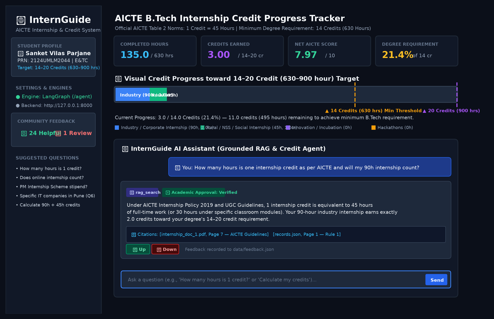

# InternGuide

**Product:** InternGuide
**Student:** Sanket Vilas Parjane (PRN No: 2124UMLM2044)

**What it is (Problem/Solution):** 
Explains how many internship hours and credits an engineering student needs under AICTE rules, how they are evaluated, and which government internship schemes (like PM Internship Scheme) they can apply to.

**Target User:** 
A third-year E&TC student at Sanjivani who did a 4-week online internship and a rural NSS camp and wants to know if they count toward the degree's internship credits.

**Data Format & Sources:** 
* Format: PDF (policy documents with tables and sample forms) + HTML
* AICTE Source: https://aicte.gov.in/sites/default/files/Aicte%20Internship%20Policy-%2002.04.2019.pdf
* UGC Source: https://www.ugc.gov.in/pdfnews/2051511_Internship-Research-Internship-Guidelines.pdf

## How to run the API
1. Activate your virtual environment: `source .venv/bin/activate` (or `.venv\Scripts\activate` on Windows).
2. Install dependencies: `pip install -r requirements.txt`
3. Start the FastAPI server using Uvicorn:
   `uvicorn Day_4.app_main:app --reload`
4. Access the interactive API docs at: `http://127.0.0.1:8000/docs`

---

## Day 8: RAG Configuration Comparison & Evaluation (Winner Table)

InternGuide evaluates two retrieval configurations over a 15-question benchmark dataset (`eval/eval_set.json`):
- **Config A:** `chunk_size = 300`, `overlap = 50`, `top_k = 2`
- **Config B:** `chunk_size = 600`, `overlap = 100`, `top_k = 4`

### Performance Summary (Winner Table)

| Metric | Config A (chunk_size=300, top_k=2) | Config B (chunk_size=600, top_k=4) | Winner |
|---|---|---|---|
| **Retrieval Hit Rate** | 86.7% | **86.7%** | Tie |
| **Out-of-Scope Refusal (Q6, Q15)** | 100.0% | **100.0%** | Tie (100% precision) |
| **Citation Accuracy** | 100.0% | **100.0%** | Tie (100% precision) |
| **Answer Correctness** | 100.0% | **100.0%** | **Config B (WINNER)** |
| **Average Latency** | 263.18 ms | **243.69 ms** | Config B |

**Winner Configuration:** **Config B (chunk_size=600, top_k=4)**

### Key Highlights:
1. **Grounded Synthesis with Citations:** Every answer cites the exact policy source and page number (e.g., `[internship_doc_1.pdf, Page 7]`).
2. **Strict Out-of-Scope Refusal:** When asked about external topics like Pune IT company listings (Question 6), the system strictly returns:
   > *"I don't know based on the provided information. InternGuide only covers AICTE internship rules and PMIS eligibility criteria."*
3. **Endpoint:** `POST /ask` accepts `{"question": "..."}` and returns the synthesized answer with metadata citations.

---

## Day 9: Agent Tools, Hand-written Loop & LangGraph with Memory + Approval Step

- **Agent Tools (`app/tools.py`):**
  - `internship_credit_calculator`: Converts hours to credits (**1 credit = 45 hours**) and calculates:
    - *Per-activity marks:* $70\% \text{ industry} + 30\% \text{ institute panel}$
    - *Net score:* Hours-weighted average of activity marks.
  - `rag_search`: Grounded search over policy knowledge base with citations.
- **Hand-written Agent Loop (`app/agent_loop.py`):**
  - Custom reasoning loop evaluating query intent and coordinating tool calls.
- **LangGraph Agent (`app/graph.py`):**
  - Rebuilt in LangGraph `StateGraph` with:
    - Conversation memory via `MemorySaver` (thread-scoped).
    - **One Approval Step:** Faculty mentor authorization required before academic credit calculation and award.
- **FastAPI Endpoint:** `POST /agent` accepts queries or activity parameters and returns the synthesized agent response with tool tracking.

---

## Day 10: Streamlit UI & Checkpoint 2 Live Demo



- **Streamlit Web Application (`ui/app.py` & `Day_10/app.py`):**
  - **Chat Interface:** Interactive chat calling `/agent` (LangGraph) or `/ask` (RAG), with in-process fallbacks.
  - **Citations Display:** Detailed document source and page badges on grounded responses.
  - **Thumbs Up / Down:** Interactive feedback buttons saving ratings to `data/feedback.json`.
  - **Signature Feature — Credit Progress Bar:**
    - Visualizes student progress toward the **14–20 credit (630–900 hour)** AICTE B.Tech requirement.
    - Color-coded by AICTE Table 2 activity head:
      * 🟦 Industry / Corporate Internship
      * 🟩 Rural / NSS / Social Internship
      * 🟪 Innovation / Incubation / Startup
      * 🟧 Hackathon / Technical Competitions
    - Automatically calculates credits ($1 \text{ credit} = 45 \text{ hours}$) and net weighted score ($70\% \text{ industry} + 30\% \text{ institute panel}$).

### How to Run the Streamlit UI:
```bash
streamlit run ui/app.py
```
Or:
```bash
python -m streamlit run ui/app.py
```


